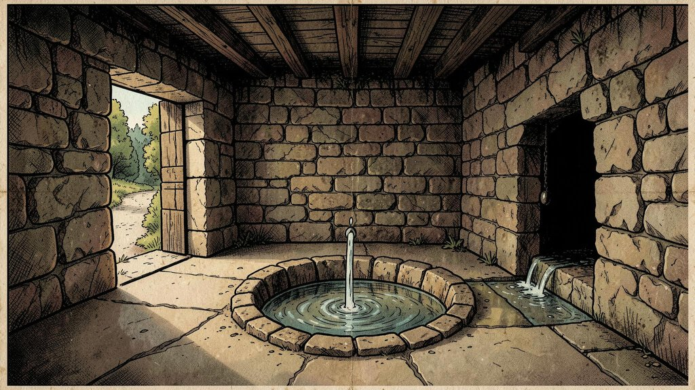
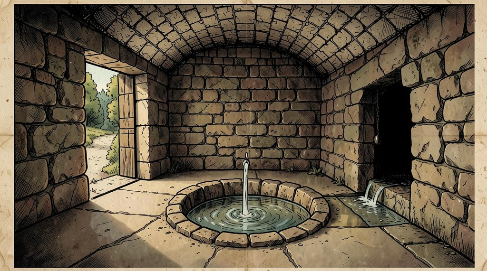

# spec-driven-generation

In spec-driven development, a person and an LLM write one spec together, with its acceptance tests, and then the LLM builds it. That works for one piece of work at a time. Here the task is the same every time, a picture for a room, but every item needs its own spec and its own tests: the doorway on the right, the water running out of the building, the grate locked. Across 200 rooms and their states, a person can't write them all.

So here a model writes each item's spec and its yes/no checks, the loop verifies both before generating, then judges each result against its checks and sends every failure back to the step that caused it: the spec, the picture, or the judge. A person sees only what the loop can't fix.

Piloted on 10 rooms from *Colossal Cave Adventure* (the [Open Adventure](https://gitlab.com/esr/open-adventure) text): each room's game text becomes a picture spec, then a picture, for a point-and-click version of the game. Built for the otari.ai hackathon (MozFest Developers Wilding).

## How it works

<!-- diagram: coming (the design of the pipeline, as an image) -->

1. **Write the spec and its checks** (`pipeline/02 - spec/`): an LLM reads a room's game text and writes a spec: the prompt to draw the picture, and the yes/no checks the picture must pass. *DeepSeek V4.1 Flash, on otari.ai.*
2. **Verify the spec and its checks** (`02 - spec/`): rules in code first, then a decision model checks that the spec and its checks are faithful to the game text. *Jev, through OpenRouter.*
3. **Repair** (`02 - spec/`): the LLM repairs each failing part, at most twice; still failing, it goes to a person. *DeepSeek, on otari.ai.*
4. **Draw** (`03 - draw/`): an image model draws the picture from the spec's prompt. *FLUX.2 klein 4B, on Modal.*
5. **Judge the picture on its checks** (`04 - judge/`): a vision model answers each check on the picture, twice; a check passes only when both runs pass it. *Gemma 4 31B, on otari.ai.*
6. **Route and correct** (`05 - route/`): a router decides what caused each failure: the spec, the picture, or the judge. The judge misread it → the picture is kept. The picture → an edit, written from the router's fix (*Qwen-Image-Edit, on Modal*), or drawn again when too much is wrong. The spec → a corrector rewrites it (*Gemma 4, on otari.ai*) and the picture is drawn again.
7. **Loop** (`06 - loop/`): the picture is judged again, at most two rounds; still failing, it goes to a person with every version.

## An example: one picture through the loop

BUILDING, the small brick building at the start of the game, with the spring inside. Each step shows one part; click to open the rest.

### The game text
*"You are inside a building, a well house for a large spring."* (`LOC_BUILDING`)
<details><summary>the room's whole input</summary>

```yaml
# location
- LOC_BUILDING:
    description:
      long: 'You are inside a building, a well house for a large spring.'
      short: 'You''re inside building.'
      maptag: !!null
    conditions: {FLUID: true, ABOVE: true, LIT: true}
    sound: STREAM_GURGLES
    travel: [
      {verbs: [OUT, OUTDO, WEST], action: [goto, LOC_START]},  # out, outdoors, west
      {verbs: [XYZZY], action: [goto, LOC_FOOF1]},  # magic word
      {verbs: [PLUGH], action: [goto, LOC_FOOF3]},  # magic word
      {verbs: [DOWNS, STREA], action: [goto, LOC_SEWER]},  # downstream, stream
    ]

# objects that start here
- KEYS:
    words: ['keys', 'key']
    inventory: 'Set of keys'
    locations: LOC_BUILDING
    descriptions:
    - 'There are some keys on the ground here.'
- LAMP:
    words: ['lamp', 'lante']
    inventory: 'Brass lantern'
    locations: LOC_BUILDING
    states: [LAMP_DARK, LAMP_BRIGHT]
    descriptions:
    - 'There is a shiny brass lamp nearby.'
    - 'There is a lamp shining nearby.'
    changes:
    - 'Your lamp is now off.'
    - 'Your lamp is now on.'
- FOOD:
    words: ['food', 'ratio']
    inventory: 'Tasty food'
    locations: LOC_BUILDING
    descriptions:
    - 'There is food here.'
- BOTTLE:
    words: ['bottl', 'jar']
    inventory: 'Small bottle'
    locations: LOC_BUILDING
    states: [WATER_BOTTLE, EMPTY_BOTTLE, OIL_BOTTLE]
    descriptions: 
    - 'There is a bottle of water here.'
    - 'There is an empty bottle here.'
    - 'There is a bottle of oil here.'
    changes:
    - 'Your bottle is now full of water.'
    - 'The bottle of water is now empty.'
    - 'Your bottle is now full of oil.'

# where each exit leads (the destination's description in the game)
# LOC_START: You are standing at the end of a road before a small brick building. Around you is a forest. A small stream flows out of the building and down a gully.
# LOC_FOOF1: >>Foof!<<
# LOC_FOOF3: >>Foof!<<
# LOC_SEWER: The stream flows out through a pair of 1 foot diameter sewer pipes. It would be advisable to use the exit.
```
</details>

### 1 · Write: the spec and its checks
DeepSeek V4.1 Flash · otari.ai · 398 s · $0.027

The spec is a list of picture decisions, each with what to draw, why, and its checks. The first of 6:

> **draw:** The inside of a small stone building built over a spring, seen in a first-person view at standing eye height, with stone walls and a stone roof overhead.<br>
> **why:** YAML: 'You are inside a building, a well house for a large spring.' The building, said in the words of what is seen: a small stone building built over a spring.<br>
> **check:** *Are stone walls visible around the room?* (good answer: yes)

<details><summary>the other picture decisions (5)</summary>

2. **draw:** In the centre of the floor, water rises up out of the ground in a round hollow of wet stone.<br>**why:** YAML: 'a well house for a large spring.' The spring inside the building.<br>**checks:** *Is water rising up out of the ground in the centre of the room?*
3. **draw:** On the left, a stone doorway in the wall opens onto a road with green forest beyond.<br>**why:** YAML travel: OUT, OUTDO and WEST lead to the road and forest of LOC_START; WEST places the way out on the left, and the road and forest are the start of where it leads.<br>**checks:** *Is a road visible through the doorway?*; *Are green trees visible through the doorway?*
4. **draw:** On the right, the water runs from the spring across the floor and out through a low dark opening in the wall.<br>**why:** YAML travel: DOWNS and STREA follow the water downstream towards the sewer; the water is the start of where it leads.<br>**checks:** *Does the water run across the floor from the spring?*
5. **draw:** The stone floor in the foreground is bare and worn smooth.<br>**why:** Open floor for the item pictures the game lays over the scene.<br>**checks:** *Is the floor in the foreground made of bare stone?*
6. **draw:** Soft daylight comes in through the open doorway on the left and spreads across the floor.<br>**why:** The room is lit (LIT: true); the open doorway is the light source.<br>**checks:** *Is light from the open doorway falling across the floor?*
</details>
<details><summary>game sentences → decisions</summary>

- *"You are inside a building, a well house for a large spring."* → decisions 1, 2
</details>
<details><summary>exits (4)</summary>

- **OUT, OUTDO, WEST** → `LOC_START`: drawn as *a stone doorway on the left*. OUT and OUTDO are walking directions and WEST is a compass direction; this is the way out of the building to the road and forest, and WEST puts it on the left.
- **XYZZY** → `LOC_FOOF1`: not drawn. XYZZY is a magic word, a shortcut and not a path.
- **PLUGH** → `LOC_FOOF3`: not drawn. PLUGH is a magic word, a shortcut and not a path.
- **DOWNS, STREA** → `LOC_SEWER`: drawn as *a stream running out through a low opening on the right*. DOWNS and STREA follow the running water of the large spring downstream, and the spring water leaves the building through the wall, so this way is drawn.
</details>
<details><summary>exit checks (3)</summary>

- *Is a stone doorway on the left visible in the image?* (good answer: yes)
- *Is a stone doorway on the left inside the picture?* (good answer: yes)
- *Is a stream running out through a low opening on the right visible in the image?* (good answer: yes)
</details>

### 2 · Verify: 52 checks · 0 fail
rules in code, then Jev (a decision model) · OpenRouter. Each question has a good answer; Jev answers with a probability of yes.

<details><summary>every question</summary>

- **unsure** Is this picture decision of img/LOC_BUILDING.jpg stated in the YAML or an allowed choice: "The stone floor in the foreground is bare and worn smooth. (why: Open floor for the item pictures the game lays over the scene.)"? (p(yes) 0.66, good answer yes)
- **pass** Is "a stone doorway on the left" something a player could see and tap in this room? (p(yes) 0.88, good answer yes)
- **pass** Is "a stream running out through a low opening on the right" something a player could see and tap in this room? (p(yes) 0.86, good answer yes)
- **pass** Is this picture decision of img/LOC_BUILDING.jpg stated in the YAML or an allowed choice: "The inside of a small stone building built over a spring, seen in a first-person view at standing eye height, with stone walls and a stone roof overhead. (why: YAML: 'You are inside a building, a well house for a large spring.' The building, said in the words of what is seen: a small stone building built over a spring.)"? (p(yes) 0.92, good answer yes)
- **pass** Is this picture decision of img/LOC_BUILDING.jpg stated in the YAML or an allowed choice: "In the centre of the floor, water rises up out of the ground in a round hollow of wet stone. (why: YAML: 'a well house for a large spring.' The spring inside the building.)"? (p(yes) 0.91, good answer yes)
- **pass** Is this picture decision of img/LOC_BUILDING.jpg stated in the YAML or an allowed choice: "On the left, a stone doorway in the wall opens onto a road with green forest beyond. (why: YAML travel: OUT, OUTDO and WEST lead to the road and forest of LOC_START; WEST places the way out on the left, and the road and forest are the start of where it leads.)"? (p(yes) 0.89, good answer yes)
- **pass** Is this picture decision of img/LOC_BUILDING.jpg stated in the YAML or an allowed choice: "On the right, the water runs from the spring across the floor and out through a low dark opening in the wall. (why: YAML travel: DOWNS and STREA follow the water downstream towards the sewer; the water is the start of where it leads.)"? (p(yes) 0.71, good answer yes)
- **pass** Is this picture decision of img/LOC_BUILDING.jpg stated in the YAML or an allowed choice: "Soft daylight comes in through the open doorway on the left and spreads across the floor. (why: The room is lit (LIT: true); the open doorway is the light source.)"? (p(yes) 0.73, good answer yes)
- **pass** Does the generation_prompt of img/LOC_BUILDING.jpg agree with the room's description in the YAML? (p(yes) 0.82, good answer yes)
- **pass** Do these draw sentences show what this sentence of the game says: "You are inside a building, a well house for a large spring."? Draw sentences: [1] "The inside of a small stone building built over a spring, seen in a first-person view at standing eye height, with stone walls and a stone roof overhead." [2] "In the centre of the floor, water rises up out of the ground in a round hollow of wet stone." (p(yes) 0.94, good answer yes)
- **pass** Does the generation_prompt of img/LOC_BUILDING.jpg name or describe any of these, or anything that could be mistaken for one: set of keys, brass lantern, tasty food, small bottle? (p(yes) 0.05, good answer no)
- **pass** If an image model draws exactly what the generation_prompt of img/LOC_BUILDING.jpg describes, would the answer to this question be yes: "Does the picture show what this sentence describes: "You are inside a building, a well house for a large spring."?"? (p(yes) 0.95, good answer yes)
- **pass** If an image model draws exactly what the generation_prompt of img/LOC_BUILDING.jpg describes, would the answer to this question be yes: "Does the image match this description: "You are inside a building, a well house for a large spring."?"? (p(yes) 0.94, good answer yes)
- **pass** If an image model draws exactly what the generation_prompt of img/LOC_BUILDING.jpg describes, would the answer to this question be yes: "Are large parts of the scene too dark to see?"? (p(yes) 0.06, good answer no)
- **pass** If an image model draws exactly what the generation_prompt of img/LOC_BUILDING.jpg describes, would the answer to this question be yes: "Is the set of keys visible anywhere in the image?"? (p(yes) 0.04, good answer no)
- **pass** If an image model draws exactly what the generation_prompt of img/LOC_BUILDING.jpg describes, would the answer to this question be yes: "Is the unlit brass lantern visible anywhere in the image?"? (p(yes) 0.05, good answer no)
- **pass** If an image model draws exactly what the generation_prompt of img/LOC_BUILDING.jpg describes, would the answer to this question be yes: "Is the loaf of bread and wedge of cheese visible anywhere in the image?"? (p(yes) 0.04, good answer no)
- **pass** If an image model draws exactly what the generation_prompt of img/LOC_BUILDING.jpg describes, would the answer to this question be yes: "Is the bottle of water visible anywhere in the image?"? (p(yes) 0.05, good answer no)
- **pass** If an image model draws exactly what the generation_prompt of img/LOC_BUILDING.jpg describes, would the answer to this question be yes: "The game takes place in a medieval fantasy world where everything is old and handmade: weathered stone, old brick, rough timber, wrought iron. Is anything out of its time or context visible in the picture, such as a metal pipe, concrete or sheet metal?"? (p(yes) 0.19, good answer no)
- **pass** If an image model draws exactly what the generation_prompt of img/LOC_BUILDING.jpg describes, would the answer to this question be yes: "Is a stone doorway on the left visible in the image?"? (p(yes) 0.98, good answer yes)
- **pass** Can this be answered by looking at the picture of img/LOC_BUILDING.jpg alone: "Is a stone doorway on the left visible in the image?"? (p(yes) 0.97, good answer yes)
- **pass** Does this ask one clear thing, that two people would read the same way: "Is a stone doorway on the left visible in the image?"? (p(yes) 0.95, good answer yes)
- **pass** If an image model draws exactly what the generation_prompt of img/LOC_BUILDING.jpg describes, would the answer to this question be yes: "Is a stone doorway on the left inside the picture?"? (p(yes) 0.95, good answer yes)
- **pass** Can this be answered by looking at the picture of img/LOC_BUILDING.jpg alone: "Is a stone doorway on the left inside the picture?"? (p(yes) 0.97, good answer yes)
- **pass** Does this ask one clear thing, that two people would read the same way: "Is a stone doorway on the left inside the picture?"? (p(yes) 0.92, good answer yes)
- **pass** If an image model draws exactly what the generation_prompt of img/LOC_BUILDING.jpg describes, would the answer to this question be yes: "Is a stream running out through a low opening on the right visible in the image?"? (p(yes) 0.96, good answer yes)
- **pass** Can this be answered by looking at the picture of img/LOC_BUILDING.jpg alone: "Is a stream running out through a low opening on the right visible in the image?"? (p(yes) 0.95, good answer yes)
- **pass** Does this ask one clear thing, that two people would read the same way: "Is a stream running out through a low opening on the right visible in the image?"? (p(yes) 0.77, good answer yes)
- **pass** If an image model draws exactly what the generation_prompt of img/LOC_BUILDING.jpg describes, would the answer to this question be yes: "Are stone walls visible around the room?"? (p(yes) 0.98, good answer yes)
- **pass** Can this be answered by looking at the picture of img/LOC_BUILDING.jpg alone: "Are stone walls visible around the room?"? (p(yes) 0.98, good answer yes)
- **pass** Does this ask one clear thing, that two people would read the same way: "Are stone walls visible around the room?"? (p(yes) 0.91, good answer yes)
- **pass** If an image model draws exactly what the generation_prompt of img/LOC_BUILDING.jpg describes, would the answer to this question be yes: "Is a stone roof visible overhead?"? (p(yes) 0.98, good answer yes)
- **pass** Can this be answered by looking at the picture of img/LOC_BUILDING.jpg alone: "Is a stone roof visible overhead?"? (p(yes) 0.95, good answer yes)
- **pass** Does this ask one clear thing, that two people would read the same way: "Is a stone roof visible overhead?"? (p(yes) 0.91, good answer yes)
- **pass** If an image model draws exactly what the generation_prompt of img/LOC_BUILDING.jpg describes, would the answer to this question be yes: "Is water rising up out of the ground in the centre of the room?"? (p(yes) 0.98, good answer yes)
- **pass** Can this be answered by looking at the picture of img/LOC_BUILDING.jpg alone: "Is water rising up out of the ground in the centre of the room?"? (p(yes) 0.96, good answer yes)
- **pass** Does this ask one clear thing, that two people would read the same way: "Is water rising up out of the ground in the centre of the room?"? (p(yes) 0.91, good answer yes)
- **pass** If an image model draws exactly what the generation_prompt of img/LOC_BUILDING.jpg describes, would the answer to this question be yes: "Is a road visible through the doorway?"? (p(yes) 0.98, good answer yes)
- **pass** Can this be answered by looking at the picture of img/LOC_BUILDING.jpg alone: "Is a road visible through the doorway?"? (p(yes) 0.96, good answer yes)
- **pass** Does this ask one clear thing, that two people would read the same way: "Is a road visible through the doorway?"? (p(yes) 0.92, good answer yes)
- **pass** If an image model draws exactly what the generation_prompt of img/LOC_BUILDING.jpg describes, would the answer to this question be yes: "Are green trees visible through the doorway?"? (p(yes) 0.96, good answer yes)
- **pass** Can this be answered by looking at the picture of img/LOC_BUILDING.jpg alone: "Are green trees visible through the doorway?"? (p(yes) 0.95, good answer yes)
- **pass** Does this ask one clear thing, that two people would read the same way: "Are green trees visible through the doorway?"? (p(yes) 0.87, good answer yes)
- **pass** If an image model draws exactly what the generation_prompt of img/LOC_BUILDING.jpg describes, would the answer to this question be yes: "Does the water run across the floor from the spring?"? (p(yes) 0.98, good answer yes)
- **pass** Can this be answered by looking at the picture of img/LOC_BUILDING.jpg alone: "Does the water run across the floor from the spring?"? (p(yes) 0.95, good answer yes)
- **pass** Does this ask one clear thing, that two people would read the same way: "Does the water run across the floor from the spring?"? (p(yes) 0.87, good answer yes)
- **pass** If an image model draws exactly what the generation_prompt of img/LOC_BUILDING.jpg describes, would the answer to this question be yes: "Is the floor in the foreground made of bare stone?"? (p(yes) 0.98, good answer yes)
- **pass** Can this be answered by looking at the picture of img/LOC_BUILDING.jpg alone: "Is the floor in the foreground made of bare stone?"? (p(yes) 0.96, good answer yes)
- **pass** Does this ask one clear thing, that two people would read the same way: "Is the floor in the foreground made of bare stone?"? (p(yes) 0.85, good answer yes)
- **pass** If an image model draws exactly what the generation_prompt of img/LOC_BUILDING.jpg describes, would the answer to this question be yes: "Is light from the open doorway falling across the floor?"? (p(yes) 0.98, good answer yes)
- **pass** Can this be answered by looking at the picture of img/LOC_BUILDING.jpg alone: "Is light from the open doorway falling across the floor?"? (p(yes) 0.92, good answer yes)
- **pass** Does this ask one clear thing, that two people would read the same way: "Is light from the open doorway falling across the floor?"? (p(yes) 0.75, good answer yes)
</details>

### 4 · Draw
FLUX.2 klein 4B · Modal · 9.0 s



<details><summary>the prompt sent</summary>

The inside of a small stone building built over a spring, seen in a first-person view at standing eye height, with stone walls and a stone roof overhead. In the centre of the floor, water rises up out of the ground in a round hollow of wet stone. On the left, a stone doorway in the wall opens onto a road with green forest beyond. On the right, the water runs from the spring across the floor and out through a low dark opening in the wall. The stone floor in the foreground is bare and worn smooth. Soft daylight comes in through the open doorway on the left and spreads across the floor. The picture fills the whole frame, edge to edge. Setting: a medieval fantasy world; everything is old and handmade: weathered stone and old brick, rough timber, wrought iron. Style: 1970s comic book art: bold black ink outlines, hand-inked hatching, flat printed colours with visible halftone dots, slightly off-register colour printing, muted earthy palette of browns, ochres, olive and amber, on aged newsprint. Mood: quiet, still and mysterious, a place long left alone.
</details>

### 5 · Judge: 19 checks · 2 fail
Gemma 4, twice · otari.ai; a check passes only when both runs pass it.

- **fail** *Is a stone roof visible overhead?* (good answer: yes) — The ceiling is made of rough timber beams, not stone.
- **flip** *Does the water run across the floor from the spring?* (good answer: yes) — run 1 (yes): Water flows from the basin area toward the opening on the right. | run 2 (no): The water stays within the basin and then flows from the right opening, but not across the main floor from the central spring.

<details><summary>every check</summary>

- **fail** Is a stone roof visible overhead?
- **flip** Does the water run across the floor from the spring?
- **pass** Does the picture show what this sentence describes: "You are inside a building, a well house for a large spring."?
- **pass** Does the image match this description: "You are inside a building, a well house for a large spring."?
- **pass** Are large parts of the scene too dark to see?
- **pass** Is the set of keys visible anywhere in the image?
- **pass** Is the unlit brass lantern visible anywhere in the image?
- **pass** Is the loaf of bread and wedge of cheese visible anywhere in the image?
- **pass** Is the bottle of water visible anywhere in the image?
- **pass** The game takes place in a medieval fantasy world where everything is old and handmade: weathered stone, old brick, rough timber, wrought iron. Is anything out of its time or context visible in the picture, such as a metal pipe, concrete or sheet metal?
- **pass** Is a stone doorway on the left visible in the image?
- **pass** Is a stone doorway on the left inside the picture?
- **pass** Is a stream running out through a low opening on the right visible in the image?
- **pass** Are stone walls visible around the room?
- **pass** Is water rising up out of the ground in the centre of the room?
- **pass** Is a road visible through the doorway?
- **pass** Are green trees visible through the doorway?
- **pass** Is the floor in the foreground made of bare stone?
- **pass** Is light from the open doorway falling across the floor?
</details>

**6 · Route** (Gemma 4 · otari.ai):

- `q13` caused by **the image** → **edit**: *Replace the wooden ceiling beams with a vaulted stone roof.* — The prompt explicitly asks for a 'stone roof overhead', but the picture shows wooden beams.
- `q17` caused by **the judge** → **keep** — The picture clearly shows a stream of water flowing across the stone floor from the central basin to the opening on the right.

**6a · Edit** (Qwen-Image-Edit · Modal · 6.1 s): *Using image 1 as the base, replace the wooden ceiling beams with a vaulted stone roof. Keep everything else exactly as it is.*



### 5 · Judge again, after edit 1: 19 checks · 1 fail
- **flip** *Does the water run across the floor from the spring?* (good answer: yes) — run 1 (no): The water is contained in a basin and does not flow across the floor. | run 2 (yes): The water flows from the central spring toward the opening on the right.

<details><summary>every check</summary>

- **flip** Does the water run across the floor from the spring?
- **pass** Does the picture show what this sentence describes: "You are inside a building, a well house for a large spring."?
- **pass** Does the image match this description: "You are inside a building, a well house for a large spring."?
- **pass** Are large parts of the scene too dark to see?
- **pass** Is the set of keys visible anywhere in the image?
- **pass** Is the unlit brass lantern visible anywhere in the image?
- **pass** Is the loaf of bread and wedge of cheese visible anywhere in the image?
- **pass** Is the bottle of water visible anywhere in the image?
- **pass** The game takes place in a medieval fantasy world where everything is old and handmade: weathered stone, old brick, rough timber, wrought iron. Is anything out of its time or context visible in the picture, such as a metal pipe, concrete or sheet metal?
- **pass** Is a stone doorway on the left visible in the image?
- **pass** Is a stone doorway on the left inside the picture?
- **pass** Is a stream running out through a low opening on the right visible in the image?
- **pass** Are stone walls visible around the room?
- **pass** Is a stone roof visible overhead?
- **pass** Is water rising up out of the ground in the centre of the room?
- **pass** Is a road visible through the doorway?
- **pass** Are green trees visible through the doorway?
- **pass** Is the floor in the foreground made of bare stone?
- **pass** Is light from the open doorway falling across the floor?
</details>

**6 · Route** (Gemma 4 · otari.ai):

- `q17` caused by **the judge** → **keep** — The picture clearly shows water flowing from the central basin across the floor to the opening on the right, as requested in the prompt.

### The result
Done: the roof is fixed by one edit, and the router keeps the picture on the water check, which the judge read both ways while the water does run across the floor.

## The whole run

9 of the 10 pilot rooms (LOC_MISTHALL's spec never came back: the writer reasoned for 10 minutes and the stream was cut). 22 pictures planned, 20 drawn and judged: **14 done, 6 to a person**; 2 not drawn, waiting for a picture that went to a person. Items: 11 of 11 done. Room scenes: 3 of 9.

**[See every picture of the run →](https://yannsay.github.io/spec-driven-generation/outputs/pipeline_example.html)**

## Run it

You need [uv](https://docs.astral.sh/uv/), an [otari.ai](https://otari.ai) key, an [OpenRouter](https://openrouter.ai) key, a [Modal](https://modal.com) account, and a [Hugging Face](https://huggingface.co) token (the image models download from it).

```
cp .env.example .env          # fill in otari_ai_key and OPENROUTER_API_KEY
uv sync
uv run modal secret create hf-secret HF_TOKEN=<your token>
uv run init.py                # checks the keys and the secret, logs in to Modal, deploys klein and Qwen-Image-Edit
uv run run.py my_run --rooms LOC_START
```

The rooms are the files in `pipeline/01 - yaml/llm_input/`. A run prints each step as it goes, and ends with its page: `outputs/pipeline_my_run.html`. One room costs about $0.03 on otari.ai and a few minutes of GPU on Modal.

## What a run writes

```
outputs/
├── specs/written/<run>/      the writer's spec and its trace (messages, reasoning, usage)
├── specs/checked/<run>*/     the spec the loop draws from, one folder per round; next to it, Jev's verdict (.jev.json) and the repairs (.repair.json)
├── pictures/<run>*/          the pictures; next to each, the judge's two runs and their combination (.judge…r1/r2/both.json) and the router's verdict (.route…json); loop.json, what the loop did
└── pipeline_<run>.html       a viewer
```

`<run>` is the first round, `<run>_r1` and `<run>_r2` the corrections, `<run>_w2` the state pictures (drawn from a done first picture).

## Licence

The code is MIT ([LICENSE](LICENSE)). The room inputs in `pipeline/01 - yaml/llm_input/` come from Open Adventure's `adventure.yaml`, Colossal Cave Adventure's text by Will Crowther and Don Woods, under the BSD 2-Clause licence: see [NOTICE](NOTICE).
